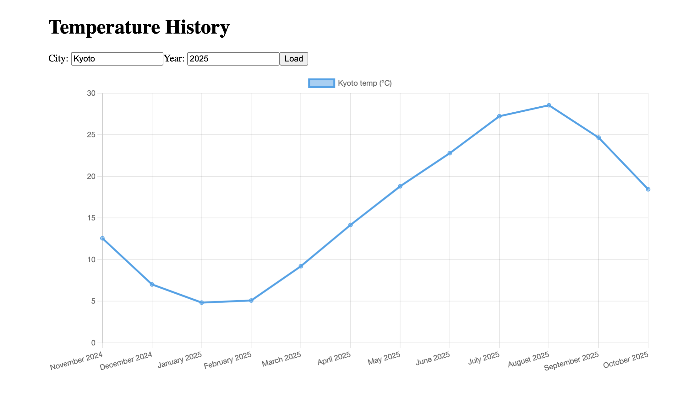
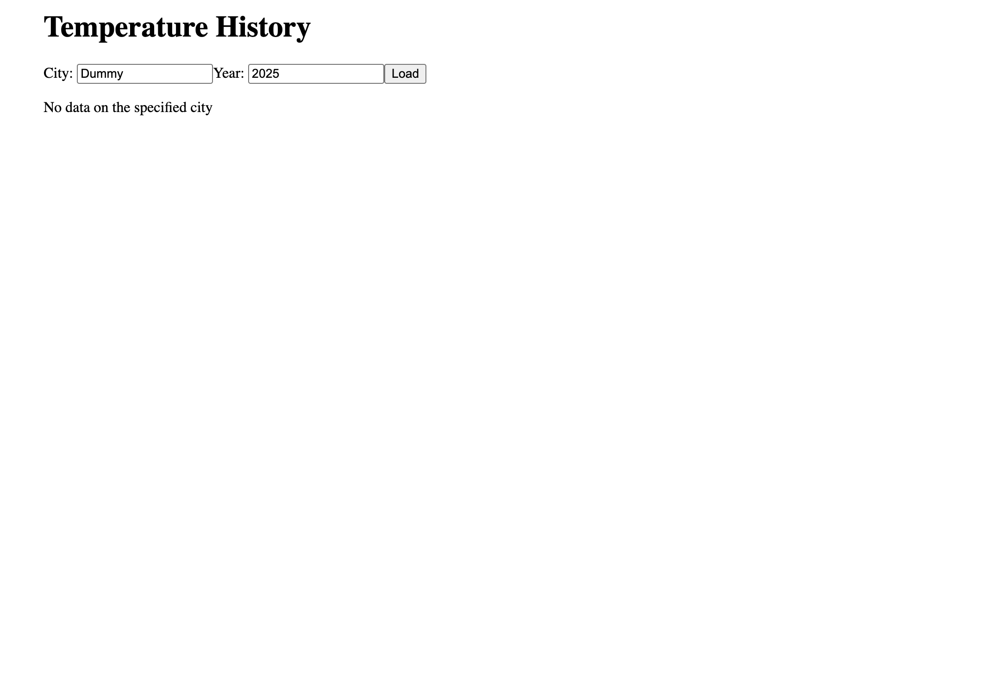

# Temperature History Dashboard

A containerised web application that displays a line chart representing the monthly average temperatures in the **past 12 months** for the specified city.
Frontend stack is **React.js** and backend stack is **Express.js**.
The frontend and backend runs on a **Kubernetes** containerised environment, with **Ingress** routing and **horizontal autoscaling** enabled. **Terraform** creates VPC subnets and IAM roles.

## Screenshot
(A line chart for a specified city)


(When the specified city is not supported)


---

## Feature

- Displays monthly average temperatures in the past 12 months
- Backend accesses OpenWeather API to retrieve temperature data
- Frontend displays a line chart, using the data from backend
- MySQL database stores cache 
- MySQL database also stores the name of cities that are used in API queries
- Frontend and backend are containerised with Docker
- Kubernetes manages the following
  - Frontend Deployment + Service
  - Backend Deployment + Service
  - Horizontal autoscaling
  - Ingress routing

---

## Architecture Overview
```
Client
|
==(Kubernetes Cluster)==
|
Ingress controller
|  |
|  Frontend Service
|  |
|  React App container (Frontend)
|
Backend Service
|
Express container (Backend)
|  |
==(Kubernetes Cluster)==
|  |
|  OpenWeather API
|
MySQL (RDS)
```
- React and Express run in separate containers
- Kubernetes handles routing & load balancing

---

## Tech Stack

- **Frontend:** React.js
- **Backend:** Express
- **Database:** MySQL (RDS)
- **Containerisation:** Docker
- **Orchestration:** Kubernetes
- **IaC:** Terraform

<!--
## Screen Shots

(The input for year is currently not used: It is fixed to the current year.)


-->

---

## Note

- You need your own OpenWeather API key.
- The db-secret.yaml used at the backend is not tracked in this repository. It needs to be created under the k8s directory. The following is a sample db-secret.yaml.
```
apiVersion: v1
kind: Secret
metadata:
  name: db-secret
  namespace: graphapp
type: Opaque
stringData:
  MYSQL_HOST: "host.docker.internal"
  MYSQL_USER: ""
  MYSQL_PASSWORD: ""
  MYSQL_DB: ""
  OPENWEATHER_KEY: ""
  ```
